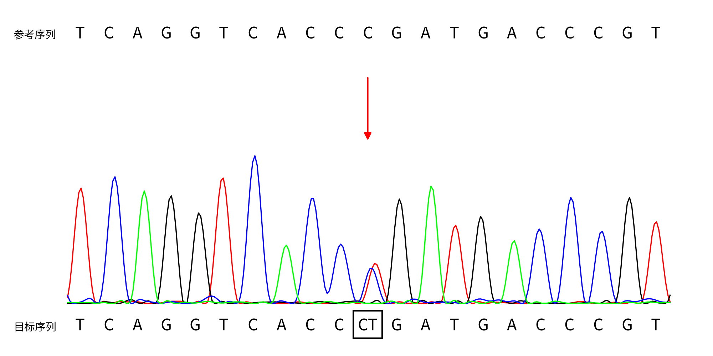

# pysangerseq —— 一代测序峰图绘制（纯 Python 重构版）

把原来的 `sangerseq-refalt_AIO.r`（约 640 行 R）完整重构为 Python 实现，
**去掉全部外部工具依赖**，输入一个 `.ab1` + 一条变异描述，输出标注好突变位点的峰图。

> 仓库名 `pysangerseq`（对应它取代的 R 包 `sangerseqR`）；
> CLI 与 Python 包名沿用 `sanger_plot`，避免与既有的 `sangerseq` 系列包撞名。

```bash
./sanger_plot.py 12-14796923-G-A C7197-...-F_....ab1
# -> C7197-...-F_....ab1.png
```

## 示例输出



*`UGT1A1 c.1091C>T` 杂合变异，反向测序（`--strand R`）。上排为参考序列、下排为测得序列；
杂合位点 `CT` 加框并落在展示窗口**正中**（第 11 位），红色箭头指向突变峰。*

```bash
./sanger_plot.py chr2:233768226 sample.ab1 --genome hg38 --strand R -o demo.png
```

> 示例所用的 `.ab1` 文件名含样本编号，**未随仓库分发**；换成你自己的 `.ab1` 即可复现。

---

## 1. 为什么重构

原流程依赖一串互相牵制的外部程序，任何一个缺失/换版本都会静默出错：

| 原依赖 | 用途 | 现状 |
|---|---|---|
| R + `sangerseqR` + `Biostrings` | basecalling、相位校正、画图 | 保留参考价值，但不想再依赖 R |
| `Cairo` R 包 | png 位图设备 | **本机已不可用**：`libcairo` → `libEGL.so.1` 缺失，`library(Cairo)` 直接报错 |
| `makeSCF`（io_lib） | 只是为了"伪造 SCF"来取参考子串 | 已用直接读 FASTA 替代 |
| `swalign` + `/usr/bin/python2` | 两处局部比对 | **python2 本机已无**；已用内置实现替代 |
| `samtools faidx` | 取参考序列 | 已用内置 `.fai` 随机访问替代 |

重构后只需要 **Python3 + numpy + matplotlib**（本机用的是
`/bi/software/Anaconda3/bin/python`，Python 3.8.3 / numpy 1.16.4 / matplotlib 3.2.2）。
不再需要 R、Cairo、makeSCF、swalign、python2、samtools。

## 2. 用法

```bash
# 默认 hg38、正向测序、输出 <ab1>.png（与原脚本命名一致）
./sanger_plot.py 12-14796923-G-A /path/to/sample.ab1

# 反向测序样本（必须显式指定！见下方"行为变化"）
./sanger_plot.py 12-14796923-G-A sample-R.ab1 --strand reverse
./sanger_plot.py 12-14796923-G-A sample-R.ab1 --strand R      # F/R 简写均可

# 指定参考基因组 / 输出路径 / 窗口宽度
./sanger_plot.py 12-14796923-G-A sample.ab1 --genome hg19 -o out.png --dlen 41

# 自定义参考基因组（优先级高于 --genome）
./sanger_plot.py 12-14796923-G-A sample.ab1 --fasta /path/ref.fa

# 调版面：SNP/INDEL 阈值、字号、杂合/trim 底色
./sanger_plot.py 12-14796923-G-A sample.ab1 --snp-max-diffs 5 --cex-base 0.9 --showhets

# 只跑流程不落盘，打印关键参数
./sanger_plot.py 12-14796923-G-A sample.ab1 --dry-run
```

变异描述支持 `chr-pos-ref-alt` 与 `chr:pos:ref:alt`，也支持只给位点
（`12-14796923`）。ref/alt 长度不等即按 INDEL 处理。

`./sanger_plot.py --help` 可看全部参数。

### 2.1 行为变化：方向不再从文件名推断

原 R 脚本用文件名正则（`R_xxx.ab1` / `-R...`）猜正反向。**本版已彻底删除该逻辑**，
方向由 `--strand` 显式决定：

| 场景 | 旧行为（R 脚本） | 新行为 |
|---|---|---|
| `..._c271-F_....ab1` | 文件名不匹配 → 正向 | `--strand` 默认 `forward` → **一致** |
| `..._c271-R_....ab1` | 文件名匹配 → 自动镜像 | 默认 `forward` → **不再镜像**；需传 `--strand reverse` 才与旧图一致 |

迁移方式：老批处理里凡是文件名含 `-R...` / `R_...` 的样本，加 `--strand reverse` 即可
（或 `--strand R`）。`--strand` 大小写不敏感，接受
`forward` / `f` / `fwd` / `+` 与 `reverse` / `r` / `rev` / `-`。

> 别混淆：还有一处**数据驱动**的翻转 —— 读序比对到参考的反向互补（`posref.rc`）时，
> 展示用参考窗口会做一次反向互补。这一处与原脚本一致、必须保留，与 `--strand` 相互独立。

### 2.2 变异坐标与「只给位点」

变异描述支持 `chr-pos-ref-alt`、`chr:pos:ref:alt`，也支持**只给位点**（`12-14796923`、
`chr2:233768226`）。两者的差别只在**位置校正**上：

| 输入 | 位置校正（`adjust_position`） |
|---|---|
| 只给位点（ref/alt 为未知） | **不做任何校正**，位点原样使用 |
| 给了 ref/alt 且长度不等（INDEL） | 按重复序列剥除法校正断点 |
| 给了 ref/alt 且长度相等且 > 1（MNV） | 反链读序时 `altposs += len(alt)` |
| 给了 ref/alt 且各 1 个碱基（SNV） | 不校正 |

> 这一条对应原 R 脚本里用字面量 `"ref"`/`"alt"` 当哨兵并**显式排除**的写法
> （`nchar(ref) > 1 && ref != "ref" && nchar(alt) > 1 && alt != "alt"`）。
> 第一版移植漏了该守卫，导致「只给位点 + 反链读序」被平移 3bp —— 详见第 5 节。

### 2.3 居中检查

断点（`altposs`）就是展示窗口的正中位点（默认第 11 位），红色箭头也只画在那里。
如果检出差异、但差异都不在正中，工具会往 **stderr** 打一条提示（不改退出码，方便批量跑时在日志里发现）：

```
WARN: 差异位点在第 8 位，不在展示窗口正中（第 11 位）——请核对变异坐标 / ref-alt / --strand；
若样本在该位点本就是野生型可忽略此提示
```

对应的字段是 `RunResult.center_mismatch` / `RunResult.center_warning()`，便于脚本判断。

### 默认路径（可用参数覆盖）

| 项 | 路径 |
|---|---|
| hg19 | `/sg2/19.yuli/02WES/Sangerseq/human_g1k_v37.fasta` |
| hg38 | `/sg2/19.yuli/02WES/Sangerseq/Homo_sapiens_assembly38.fasta` |
| 中文字体 | `/sg2/7.hudahui/CNV/cnv_master/cnv/src/utility/fonts/SourceHanSansSC-Regular.otf` |

> 注意 hg38 那个 fasta 里染色体名**不带 `chr` 前缀**（`12` 而不是 `chr12`）；
> 代码对带/不带 `chr` 都做了兼容。

## 3. 模块结构

```
sanger_plot.py              CLI 入口（--strand 等参数在这里暴露）
sanger_plot/
  abif.py                   ABIF(.ab1) 解析 —— 对齐 sangerseqR::read.abif 的字节偏移
  reference.py              FASTA(.fai) 随机访问 —— 替代 samtools faidx
  sangerseq.py              getpeaks / makeBaseCalls / basecalldf / setAllelePhase
  swalign_local.py          Smith-Waterman 局部比对 —— 逐行移植 swalign 库
  align.py                  Biostrings::pairwiseAlignment(type="local") 等价实现
  variant.py                变异描述解析 + INDEL 断点位置校正
  render.py                 峰图绘制（chromatogramref 等价）
  pipeline.py               端到端编排 + parse_strand / locate_anchor / locate_and_trim
tests/
  make_r_dump.r             从原 script.r 生成中间量 dump（不画图，故不需要 Cairo）
  compare_r_dump.py         把 Python 的中间量与 R 的 dump 逐项比对（复用 pipeline 的共享函数）
  run_all.sh                端到端回归（SNV / 插入 / 缺失 × F 向 / R 向）
```

### 3.1 参数归属（避免两处各传一份）

| 参数 | 归属 | 说明 |
|---|---|---|
| `dlen` | `run(dlen=...)` | 它同时参与算法（`dlen2` 决定锚定片段长度与 trim），所以不在 `RenderOptions` 里；`chromatogram(dlen=...)` 显式接收 |
| `strand` | `run(strand=...)` / `--strand` | 字符串入参，经 `parse_strand()` 归一化为布尔；渲染层只收 `chromatogram(reverse=bool)`，不解析字符串 |
| `snp_max_diffs` / `cex_*` / `letter_scale` / `showhets` / `showtrim` | `RenderOptions` | 纯渲染选项，由 CLI 组装 |
| `ratio` / `phase_trim5` / `phase_trim3` | `run(...)` | 算法阈值 |

## 4. 算法要点（与原 R 完全一致的部分）

1. **解析 `.ab1`**：取 `DATA.9~12` 四条通道，按 `FWO_` 标签重排成 A/C/G/T；
   `PLOC.2` 给峰位、`P1AM.1/P2AM.1` 给峰高、`PBAS.2/P2BA.1` 给主/次碱基。
   原实现用 **SInt16 有符号**读这些值（>32767 会变负数），这里刻意保持一致。
2. **`makeBaseCalls(ratio=0.3)`**：在每条 primary 峰位划分窗口，取四通道窗口内
   最大峰；峰高比例 < 0.3 的通道判为 NA；一个都不剩或四个全在 → `N`，
   剩多个 → 主碱基取最高、次碱基取其余碱基的 IUPAC 合并码。
3. **`setAllelePhase(ref, trim5=29, trim3=30)`**：用参考序列当骨架做 local 比对
   （正/反向互补取分高者），把读序校正成"参考等位 / 非参考等位"两条轨道。
4. **两次 `swalign`**：
   - 第一次用断点上游 21bp 锚定，判断读序链方向，并探测锚定片段是否压到 INDEL；
   - 第二次用断点一侧 20bp 锚定，算出 `trim5len/trim3len`。
   若比对结果含 `D/I`，换另一侧重算，公式由 `+dlen2` 改为 `-dlen2-1`。
5. **INDEL 断点校正**：在重复序列（poly-A、短串联重复）里同一段插入/缺失有多个
   等价写法；原脚本用"把重复单元从参考里剥掉、数剥掉的长度"来定位真正的断点，
   逻辑照搬。
6. **出图**：参考序列在上、目标序列在下，差异位点加框（差异 ≤ `snp_max_diffs` 判为
   SNP 逐个加框，否则按 INDEL 只展示次等位），红色箭头指向突变峰；
   `--strand reverse` 时整幅图镜像翻转（曲线、碱基字母反向互补、配色整体反转），
   保证正反向出图一致。配色 A=绿 C=蓝 G=黑 T=红。
7. **两处翻转必须分清**（易错点）：
   - `posref.rc` —— 读序比对到参考的反向互补 → 展示窗口做一次反向互补。**数据驱动**，
     与原脚本一致，必须保留；
   - `--strand` —— 测序方向（原来由文件名正则推断）。**人为入参**，默认 forward。

## 5. 与原脚本的有意差异

| 差异 | 说明 |
|---|---|
| 参考子串来源 | 原为 `samtools faidx` → `makeSCF` → `read.scf` → `subseq(30,500)`；现直接取 `region[29:529]`（等价，见下方验证） |
| `swalign` 调用 | 原为外部命令，现为内置移植实现 |
| **`sed -n 2p` → 数据行** | 原脚本写 `\| sed -n 2p` 抓 swalign 输出，实测拿到的是 dump 的第 2 行 `"Ref  : ..."`（只有 5 个字段），`posref2[7]` 是 `NA`，**在当前环境直接报错跑不完**。语义上应取最后一行数据行；这里按语义实现 |
| 字体高度 | R 用 SimSun，拉丁大写约占 0.875em；SourceHanSansSC 约 0.73em，故默认乘 `letter_scale=1.13` 使视觉字号一致。设 1.0 即严格照搬 R 的 pt 值 |
| **方向判定方式** | 原为文件名正则自动推断（含"整个入参路径"匹配的隐式行为）；现改为 `--strand` 显式入参、默认 `forward`。行为变化与迁移见 [2.1](#21-行为变化方向不再从文件名推断) |
| SNP/INDEL 阈值 | 原脚本把 `diff <= 3` 硬编码在 3 处；现统一为 `--snp-max-diffs`（默认 3） |
| 输入校验 | 新增：位点越界、染色体名缺失、参考骨架取不满 500bp、展示窗口取不满 `dlen`、`trim5/trim3` 为负，都会给出可读报错（原脚本会静默跑偏或裸报 `NA`） |
| 居中检查 | 新增 `RunResult.center_mismatch` 与 stderr 提示（见 [2.3](#23-居中检查)）；原脚本只出图、不报 |
| `RunResult.arrow_pos` | 图里没画箭头时返回 `None`（原先即使 `draw_arrow=False` 也返回坐标，CLI 摘要会误导） |
| **修正：只给位点时的位置平移** | 第一版移植漏抄了 R 的 `"ref"/"alt"` 哨兵守卫，导致「只给位点 + 反链读序」被平移 `len("alt")=3` → 变异位点偏离正中且丢失箭头。现已与 R 对齐（`adjust_position` 开头守卫） |

## 6. 验证

### 6.1 数值逐项比对（`tests/run_all.sh`）

`tests/make_r_dump.r` 把原 `script.r` 从 `chromatogramref()` 定义处截断（跳过画图，
因此不需要 Cairo），再追加 dump 代码，产出中间量；`compare_r_dump.py` 与 Python 实现
逐项对比。当前覆盖 5 种变异写法 × 2 个测序方向 = **10 个用例**，**全部 ALL OK**：
ABIF trace/峰位/主次碱基、`makeBaseCalls` 结果、参考 500bp、种子序列、
`setAllelePhase` 的比对区间与主次读序、两次 swalign 的坐标/链向/CIGAR、
校正后断点、`trim5len/trim3len`、展示参考窗口、`--strand` 归一化与别名表。

```
$ bash tests/run_all.sh
PASS  12-14796923-G-A   ...-F_...B07.ab1
PASS  12-14796923-G-A   ...-R_...H01.ab1
PASS  12-14796923-G-GTT ...          （插入）
PASS  12-14796923-GT-G  ...          （缺失）
PASS  12-14796923-G-GA  ...          （MNV）
PASS  12-14796923       ...          （只给位点）× F/R 两向
== 汇总: PASS=10 FAIL=0 SKIP=0 ==
```

> 测试与实现共用 `pipeline.locate_anchor()` / `pipeline.locate_and_trim()`，
> 不各写一份，避免再次出现"实现改了、测试没跟上"的漂移。
>
> **用例覆盖面的教训（两次都是"没覆盖到"而不是"写错了"）**：
> 1. 只影响 INDEL 分支的 bug（把 `Alignment.cigar` 列表当字符串判 `"D" in cigar`）：
>    SNV 用例全过，只有插入/缺失能暴露；
> 2. 只影响"只给位点 + 反链"的 bug（漏哨兵守卫 → +3）：带 ref/alt 的用例全过，
>    只有"只给位点"能暴露。新增该用例后**修复前 FAIL、修复后 PASS**。

### 6.2 真样本验证（UGT1A1 三个样本）

| 样本 | 命令要点 | 校正后断点 | 展示参考窗口（= 报告里的「前后碱基」） | 加框位点 | 箭头 |
|---|---|---|---|---|---|
| c.1091C>T（反向） | `chr2:233768226 --strand R` | 233768226 | `TCAGGTCACCCGATGACCCGT` | **[11]** | 有 |
| c.211G>A（正向） | `chr2:233760498` | 233760498 | `CATCAGAGACGGAGCATTTTA` | [11] | 有 |
| c.-3275T>G（正向） | `chr2:233757013` | 233757013 | `AGAGTTCAGTTTGAACAAAGC` | [11] | 有 |

修复前后对比：c1091 图片有变化（bug 生效→修正），**c211 / c-3275 逐像素 0 差异**
（正向样本本来就不触发该 bug，确认没有误伤）。

另一条独立交叉验证：报告里的「峰图位置」列 —— c211 是 96↔96、c-3275 是 160↔160
（精确吻合）；c1091 是 106↔105，差 1 的原因是该文件 `PBAS.2` 有 273 个碱基、
`makeBaseCalls` 丢弃了 1 个"四通道窗口全空"的峰窗 → 272，而报告的编号基于
**原始 ABIF 碱基数组**。两者都是自洽的，反过来证明 `trim5len` 的锚定正确。

### 6.3 与 R 原图的像素比对

拿原脚本已产出的参考图
`C7197-...-WBP11-c271-F_...B07.ab1.png` 做像素级对照，关键要素完全对齐：

| 要素 | R 原图 | Python |
|---|---|---|
| 方框列范围 | 991..1074 | 991..1074 |
| 方框行范围 | 871..951 | 871..951 |
| 曲线列范围 | 188..1884 | 188..1884 |
| 顶部碱基字母行 | 74..107 | 75..107 |
| 底部碱基字母行 | 894..927 | 895..927 |
| 中文标签行 | 84..110 / 903..930 | 83..110 / 904..930 |

（方框位置一致 ⇒ 绘图区几何、`ylims`、碱基位置 `pos` 全部一致。）

**改造后回归（`--strand` 参数化当次）**：

| 对比 | 不同像素数 |
|---|---|
| F 向样本，默认参数 vs 改造前基线 | **0**（逐像素完全一致） |
| R 向样本 `--strand reverse` vs 改造前（文件名自动镜像） | **0**（逐像素完全一致） |
| R 向样本默认 `forward` vs `--strand reverse` | 133189（6.66%，确认参数确实生效且互为镜像） |

## 7. 本机环境备忘

想在**本机**复跑原始 R 脚本（只为做基线）的话，需要：

```bash
export LD_LIBRARY_PATH=/bi/7.hudahui/soft/conda/lib:/bi/software/R-4.0.2/lib64/R/lib:/usr/lib64:\
/bi/software/staden-2.0.0b11-2016-linux-x86_64/lib:/bi/5.liangyuanyuan/sw/io_lib-1.14.8/lib:/bi/software/Python-2.7.18/lib
export R_LIBS=/bi/software/R-4.0.2/lib64/R/library
```

并且必须做两处修补（`tests/make_r_dump.r` 已自动完成）：

1. 注释掉 `library(Cairo, quietly=TRUE)` —— 本机缺 `libEGL.so.1`，Cairo 包加载失败；
   另外 R 的 `png(type="cairo")` 同样因为 `libcairo.so.2` 依赖 `libEGL.so.1` 而失败，
   所以本机也**无法**用 R 画出 png（现有的参考 png 是别的环境产出的）。
2. `|sed -n 2p` 改成 `|tail -1`，见第 5 节。

`makeSCF` 还需要 `libstaden-read.so.11`（来自 staden 那一段 `LD_LIBRARY_PATH`）。
